  
  &nbsp;
  
  &nbsp;
  

Ingeniero de software senior con más de 6 años construyendo soluciones a nivel empresarial. Hoy trabajo en **Forus**, entre retail e IA: modernización de sistemas legacy, migraciones, integraciones y sistemas multiagente.

## Qué construyo

| | |
|---|---|
| **Microservicios** | Sistemas grandes divididos en servicios pequeños con Spring Boot y Go, cada uno con sus datos, desplegados sobre Kubernetes. |
| **Arquitectura orientada a eventos** | Kafka para flujos de eventos y RabbitMQ para colas de trabajo, con sincronización de inventario en tiempo real. |
| **Modernización de legacy** | Aplicaciones Delphi reescritas por partes en Spring Boot, Go, Python y React, conviviendo con el sistema anterior. |
| **Migración de ERP** | De Oracle E-Business Suite a Oracle Fusion Cloud. |
| **Sistemas multiagente** | Un orquestador reparte el trabajo: un agente busca contexto en el grafo de conocimiento, otro escribe el cambio y otro lo revisa. |

## Stack

<picture>
  <source media="(prefers-color-scheme: dark)" srcset="assets/stack-dark.svg" />
  
</picture>

## Trayectoria

<picture>
  <source media="(prefers-color-scheme: dark)" srcset="assets/trajectory-dark.svg" />
  
</picture>

## En lo que ando

- [**agents-learning**](https://github.com/ManuelEV/agents-learning) · Apuntes sobre cómo construir agentes en ambientes empresariales.
- [**simulador-hipotecario**](https://github.com/ManuelEV/simulador-hipotecario) · Simulador parametrizable para saber en cuánto queda tu dividendo según precio (UF o CLP), tasa de interés y años.
- [**my-landing**](https://github.com/ManuelEV/my-landing) · El código de [alguien.dev](https://alguien.dev/), hecho con Vite, React, TypeScript y Tailwind CSS.

## Fuera del código

  
  &nbsp;
  
  &nbsp;
  
  &nbsp;
  
  &nbsp;
  

